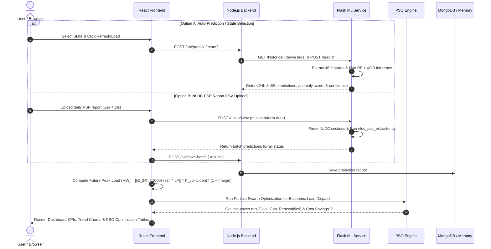

# ⚡ EnergyIQ — Application Workflow

This document details the end-to-end workflow, architectural design, mathematical formulas, data processing lifecycle, and component interactions of the EnergyIQ system.

---

## 1. 🏗️ High-Level System Architecture

```
┌────────────────────────────────────────────────────────────────────────┐
│                             USER / BROWSER                             │
│                  React Frontend (Vite / React Router v6)               │
│   Pages: Dashboard | Analytics | Optimization (PSO) | Reports | Upload │
└───────────────────────────────────┬────────────────────────────────────┘
                                    │ HTTP / REST API (Port 5000)
                                    ▼
┌────────────────────────────────────────────────────────────────────────┐
│                          NODE.JS / EXPRESS                             │
│               Backend Server, Controllers & Export Engine              │
└──────────────┬──────────────────────────────────┬──────────────────────┘
               │                                  │
  HTTP Proxy   │                                  │ MongoDB (Port 27017)
  (Port 5001)  ▼                                  ▼ / Memory Fallback
┌─────────────────────────────────────┐ ┌────────────────────────────────┐
│          FLASK ML SERVICE           │ │      MONGODB / IN-MEMORY       │
│ (RF, XGB, IsolationForest, Extractor)│ │       PREDICTION LOG DB        │
└─────────────────────────────────────┘ └────────────────────────────────┘
```

---

## 2. 🔄 End-to-End Data Workflow



---

## 3. 🎯 Step-by-Step Feature Workflows

### A. Energy Demand & Future Peak Load Prediction Workflow
1. **User Selection / Auto Trigger**: The user selects a target state on the Dashboard.
2. **Lag Feature Auto-Derivation**: If explicit lag values are omitted, Express fetches historical demand trends from Flask `/historical` to derive `demand_lag_1d`, `demand_lag_7d`, and `rolling_7d_mean`.
3. **ML Inference Pipeline**:
   - Python constructs a 46-feature vector (lags, rolling averages, seasonality flags, and state one-hot encoding).
   - Standardized via `scaler.pkl`.
   - Evaluated using pre-trained `rf_model.pkl` (Random Forest) and `xgb_model.pkl` (XGBoost).
   - Ensemble demand calculated as the average of RF and XGB outputs.
   - Chained 48h forecast generated using 24h RF prediction as the next day's lag input.
4. **Future Peak Load Conversion (MW)**:
   - Converts 24h energy demand $E_{24h}$ (in MU) to peak power load $P_{\text{peak}}$ (in MW) using grid load dynamics:
   $$\text{Average Power (MW)} = \frac{E_{24h} \times 1000}{24}$$
   $$P_{\text{peak}} = \left( \frac{\text{Average Power}}{\text{Load Factor}} \right) \times K_{\text{coincidence}} \times (1 + \alpha_{\text{contingency}})$$
   - *Parameters*: Grid Load Factor ($\text{LF}$) = 0.78 (78%), Coincidence Factor ($K_{\text{coincidence}}$) = 1.12, Contingency Reserve ($\alpha_{\text{contingency}}$) = 0.05 (5%).
5. **Persistence**: Prediction logs stored in MongoDB (or in-memory fallback store).

---

### B. Automated NLDC PSP Report Extraction Workflow
1. **File Upload**: User uploads daily National Load Despatch Centre (NLDC) Power Supply Position (PSP) report (`.csv`, `.xls`, `.xlsx`) via the **Upload CSV** page or Dashboard upload prompt.
2. **Parsing & Feature Extraction**: `nldc_psp_extractor.py` parses multi-section report structures:
   - Extracts state-level actual energy met (MU) and max demand (MW).
   - Maps state names to standardized feature columns.
   - Calculates lag values and rolling 7-day averages.
3. **Batch Prediction**: Executes 24h & 48h RF/XGB ensemble predictions across all states.
4. **Auto-Save & Export**: Results are sent to `/api/save-batch` to update database logs and made downloadable as a structured CSV.

---

### C. Particle Swarm Optimization (PSO) for Economic Load Dispatch Workflow
1. **Trigger**: User navigates to the **Optimization** page or requests PDF/CSV report exports.
2. **Input Demand**: Uses predicted 24h energy demand $E_{24h}$ per state.
3. **Swarm Initialization**:
   - Initializes a swarm of 30 particles over 50 iterations.
   - 3 Generator Types with quadratic cost functions $C_i(P_i) = a_i + b_i P_i + c_i P_i^2$:
     - **Coal Generator**: $P \in [10, 1000]\text{ MW}, a=500, b=15, c=0.05$
     - **Gas Generator**: $P \in [10, 1000]\text{ MW}, a=400, b=20, c=0.06$
     - **Renewables (Solar/Wind)**: $P \in [0, 500]\text{ MW}, a=0, b=5, c=0.01$
4. **Velocity & Position Updates**:
   $$v_{i,j}^{(k+1)} = w \cdot v_{i,j}^{(k)} + c_1 r_1 \left(pbest_{i,j} - x_{i,j}^{(k)}\right) + c_2 r_2 \left(gbest_j - x_{i,j}^{(k)}\right)$$
   $$x_{i,j}^{(k+1)} = x_{i,j}^{(k)} + v_{i,j}^{(k+1)}$$
5. **Optimization Metrics**:
   - Calculates **Prior Cost** (naive equal distribution across generators).
   - Calculates **Optimized Cost** (PSO optimal dispatch).
   - Computes **Cost Savings (%)** and outputs exact optimal generation mix (Coal MU, Gas MU, Renewables MU).

---

### D. Anomaly Detection Workflow
1. **Scoring**: Every prediction output (`rf_ratio`) is evaluated through pre-trained `isolation_forest.pkl`.
2. **Severity Classification**:
   - Score $> -0.35$: Normal / High Confidence
   - $-0.35 \ge \text{Score} > -0.61$: Low Anomaly Risk
   - Score $\le -0.61$: High Anomaly Risk
3. **Integration**: Anomaly flags and scores are embedded directly into batch CSV tables, database logs, and PDF/CSV report exports. *(Note: Standalone anomaly dashboard cards were streamlined into integrated report outputs).*

---

### E. Model Analytics & Comparison Workflow
1. **Selection**: User visits the **Analytics** page.
2. **Backend Query**: Express retrieves aggregated statistics via `/api/analytics`.
3. **Historical Summary & State Stats**:
   - Renders state-wise historical average demand bar charts.
   - Renders state prediction statistics table with sorting options.

---

### F. Report Export Workflow (PDF & CSV)
1. **User Action**: User filters by state (or All States) on the **Reports** page.
2. **Processing**:
   - Express fetches latest prediction records.
   - Executes PSO Economic Dispatch for each state record.
   - **PDF Export**: Renders structured tables detailing State, Date, Final Demand (MU), Anomaly status, Coal MU, Gas MU, Solar MU, Per-Unit Cost (₹), and Cost Savings (%).
   - **CSV Export**: Generates raw CSV formatted via `json2csv`.
3. **Download**: Prompt binary file download served to browser.

---

## 4. ⚙️ Execution Flow

```
[Start Application]
       │
       ├──> 1. Launch ML Service:  `python app.py` in /ml-service (Port 5001)
       │         └── Loads scaler.pkl, rf_model.pkl, xgb_model.pkl, isolation_forest.pkl
       │
       ├──> 2. Launch Backend:     `npm run dev` in /server (Port 5000)
       │         └── Connects to MongoDB (or activates in-memory fallback)
       │
       └──> 3. Launch Frontend:    `npm start` in /client (Port 3000 / Vite)
                 └── Opens browser interface (Login -> Dashboard)
```

